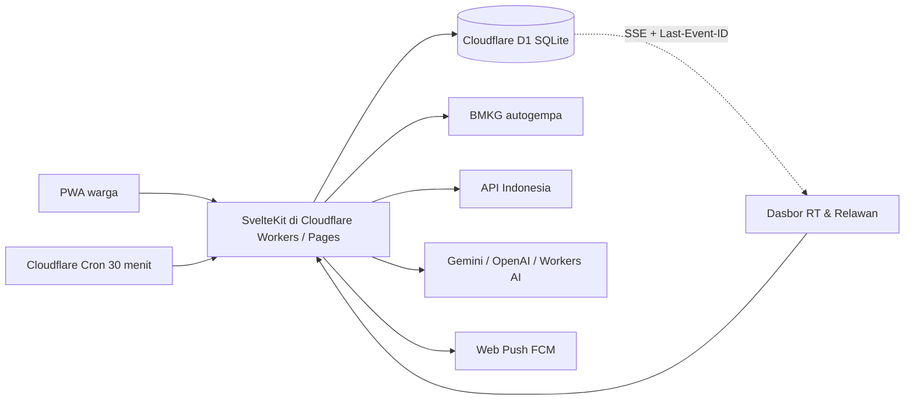

# Friendly Neighborhood

Jaringan siaga kelurahan. Warga menerima kabar peringatan, menekan **Saya aman** atau **Butuh bantuan**, dan ketua RT beserta relawan melihat siapa yang belum merespons. Antarmuka berbahasa Indonesia.

| | |
| --- | --- |
| **Nama tim** | CaseyInfokanNamaTIm |
| **Nama aplikasi** | Friendly Neighborhood |
| **Kategori** | Web (PWA) |
| **Subtema** | Public Service & Smart Governance |
| **Institusi** | Program Studi Sistem Informasi, Universitas Tarumanagara |

**Masalah yang diselesaikan.** Saat ada peringatan dini cuaca atau gempa dari BMKG, kabar resmi belum tentu sampai ke setiap rumah, dan ketua RT tidak punya cara cepat untuk tahu siapa yang sudah aman dan siapa yang belum memberi kabar, terutama lansia, penyandang disabilitas, dan keluarga dengan bayi. Koordinasi lewat grup chat membuat kabar tercecer dan rumah yang sama bisa dicek dua kali sementara rumah lain terlewat. Friendly Neighborhood menyatukan peringatan, konfirmasi keselamatan warga, dan pembagian tugas pengecekan dalam satu alur sampai ke tingkat kelurahan.

**Target pengguna.** Warga yang terdaftar di sebuah kelurahan, ketua RT dan relawan yang mengoordinasikan pengecekan, serta pihak kelurahan yang memantau rekap lintas-RT.

Mode demo berjalan langsung tanpa kunci API eksternal menggunakan database **Cloudflare D1 (SQLite)**: kelurahan contoh adalah **Kel. Tomang, Grogol Petamburan, Jakarta Barat**.

## Fitur Utama

Fitur yang sudah berjalan di aplikasi ini:

| Fitur | Pengguna | Halaman |
| --- | --- | --- |
| Registrasi, masuk, dan pemilihan wilayah resmi (provinsi sampai kelurahan) | Warga, RT, relawan | `/daftar`, `/masuk`, `/wilayah` |
| Penanda kerentanan (lansia, disabilitas, keluarga dengan bayi) dengan persetujuan eksplisit | Warga | `/kerentanan`, `/izin` |
| Kejadian siaga dari pemantauan BMKG terjadwal (Cron 30 menit) | Sistem | `/api/cron/poll` |
| Notifikasi Web Push ke warga di wilayah terdampak | Warga | `/api/push/subscribe` |
| Respons satu ketukan **Saya aman** / **Butuh bantuan** dengan lokasi GPS dan jenis bantuan | Warga | `/siaga/[id]`, `/siaga/[id]/bantuan` |
| Dasbor RT/relawan: peta dan daftar status warga, warga rentan yang belum merespons di urutan teratas | RT, relawan | `/rt` |
| Klaim **Saya cek** atomik agar tidak ada kunjungan ganda, lalu **Tandai aman** | RT, relawan | `/rt/warga/[id]` |
| Sinkronisasi langsung antar-tab lewat Server-Sent Events | RT, relawan, kelurahan | `/api/stream` |
| Panel Kelurahan: rekap lintas-RT dan eskalasi otomatis warga rentan yang belum tertangani lewat batas waktu 15 menit, plus tombol simulasi eskalasi untuk demo | Kelurahan, RT | `/kelurahan` |
| Mode simulasi/latihan siaga berlabel **SIMULASI** tanpa memanggil API luar | RT | `/rt/simulasi` |
| Ringkasan situasi berbasis AI dari data agregat saja | RT | `/rt/ringkasan`, `/api/ai/ringkasan` |
| Pengumuman RT dan daftar calon posko | RT | `/rt/pengumuman`, `/rt/posko` |
| Fasilitas terdekat dan prakiraan cuaca kelurahan | Warga | `/fasilitas`, `/cuaca` |
| Riwayat kejadian beserta rekap respons | Warga, RT | `/riwayat`, `/riwayat/[id]` |
| Hapus data akun | Warga | `/profil/hapus` |
| PWA yang dapat dipasang di ponsel | Semua | `manifest.webmanifest`, service worker |

## Menjalankan Lokal

```sh
bun install
bun run d1:migrate:local
bun run dev
```

**Konfigurasi minimum untuk demo lokal:** cukup Bun dan tiga perintah di atas. Tidak ada kunci API atau secret yang wajib diisi; tanpa `.dev.vars`, aplikasi memakai kunci sesi bawaan untuk pengembangan, data contoh Kel. Tomang, ringkasan AI berbasis templat, dan mode simulasi tanpa API luar. Variabel di bagian [Variabel Lingkungan & Secret](#variabel-lingkungan--secret) hanya diperlukan untuk data live dan produksi.

Aplikasi ada di [http://localhost:43721](http://localhost:43721). Saat pertama kali diakses, database D1 lokal otomatis terisi akun dan data contoh Kel. Tomang bila masih kosong.

Akun contoh, kata sandi `demo1234`:

| Peran | Nama | Nomor HP |
| --- | --- | --- |
| Warga | Sari Lestari | 081234567890 |
| Ketua RT | Dina Rahmawati | 081300000001 |
| Relawan | Rudi Hartanto | 081300000002 |

Skrip demo kompetisi: masuk sebagai Dina, buka **Simulasi siaga**, pilih **Hujan lebat**, mulai. Hartono Wijaya (lansia) muncul di urutan atas. Buka detailnya, ketuk **Saya cek**, status menjadi **Sedang dicek oleh Dina R.** secara atomik di database D1 (relawan lain tidak bisa mengklaim ganda, dan tab lain ikut berubah lewat SSE). Lalu **Tandai aman**.

## Arsitektur



- Backend berjalan penuh di **Cloudflare Workers & Pages** memakai `@sveltejs/adapter-cloudflare` dan database relasional **Cloudflare D1** (`migrations/0001_init.sql`).
- Klaim tombol **Saya cek** dieksekusi dengan query kondisional atomik di SQLite/D1 sehingga dua relawan tidak dapat mengklaim warga yang sama secara bersamaan.
- Sinkronisasi langsung antar-tab dan antar-isolate memakai Server-Sent Events (`GET /api/stream`) dengan tabel `live_events` dan header standar `Last-Event-ID`.
- Pantauan cuaca memakai API Indonesia hanya di sisi server. Gempa memakai umpan gratis `data.bmkg.go.id/DataMKG/TEWS/autogempa.json`.
- `SIMULASI` membuat kejadian berlabel `is_simulation` dan tidak memanggil API luar.
- Ringkasan AI (`POST /api/ai/ringkasan`) hanya mengirim angka agregat tanpa data pribadi perorangan. Mendukung `GEMINI_API_KEY`, `LLM_API_KEY` (OpenAI-compatible), binding Cloudflare Workers AI (`AI`), atau fallback templat otomatis.

## Variabel Lingkungan & Secret

Untuk pengembangan lokal, buat berkas `.dev.vars` (sudah diabaikan oleh `.gitignore`). Untuk produksi di Cloudflare, pasang secret menggunakan `bunx wrangler secret put <NAMA>`:

| Variabel | Fungsi |
| --- | --- |
| `SESSION_SECRET` | Kunci HMAC penanda sesi cookie (`fn_session`) |
| `API_INDONESIA_KEY` | Wilayah, cuaca, peringatan dini, fasilitas (`x-api-key`) |
| `GEMINI_API_KEY` atau `LLM_API_KEY` | Kunci model bahasa untuk ringkasan situasi agregat |
| `LLM_BASE_URL`, `LLM_MODEL` | Opsional; override endpoint/model OpenAI-compatible |
| `PUBLIC_VAPID_KEY`, `VAPID_PRIVATE_KEY`, `VAPID_SUBJECT` | Kunci VAPID untuk Web Push melalui FCM |
| `CRON_SECRET` | Melindungi endpoint `GET/POST /api/cron/poll` |

## Deploy ke Cloudflare Workers / Pages

### Opsi A — Cloudflare Workers + Static Assets + D1 + Cron (Direkomendasikan)

Satu perintah `deploy` akan membangun aplikasi, memasang handler Cron Trigger tiap 30 menit (`*/30 * * * *`), otomatis membuat database D1 `friendly-neighborhood-db` bila belum ada, dan mengunggah aset statis beserta Worker:

```sh
bunx wrangler login
bun run deploy
bun run d1:migrate:remote
```

Pasang secret produksi bila diperlukan:

```sh
bunx wrangler secret put SESSION_SECRET
bunx wrangler secret put API_INDONESIA_KEY
bunx wrangler secret put GEMINI_API_KEY
bunx wrangler secret put CRON_SECRET
```

Cek status backend yang sudah ter-deploy di `GET /api/health`.

### Opsi B — Cloudflare Pages

Jika ingin men-deploy sebagai proyek **Cloudflare Pages** (atau menghubungkan repositori GitHub ke menu **Workers & Pages > Create > Pages**):

1. Build command: `CF_PAGES=1 bun run build`
2. Build output directory: `.svelte-kit/cloudflare`
3. Tambahkan binding D1 bernama `DB` di **Settings > Bindings > D1 database** pada dashboard Pages.
4. Atau deploy langsung lewat CLI:

```sh
bun run deploy:pages
```

## API Indonesia

Basis: `https://use.apiindonesia.id`. Setiap permintaan berhasil memotong 2 kredit (Rp2). Permintaan gagal tidak dipotong. Akun baru mendapat bonus 3.000 kredit sekali.

Endpoint yang dipakai:

- `GET /api/v1/wilayah/provinsi`, `/kabupaten`, `/kecamatan`, `/kelurahan`
- `GET /api/v1/cuaca?adm4=`
- `GET /api/v1/peringatan-dini?provinsi=`
- `GET /api/v1/fasilitas/nearby`

Impor wilayah penuh ke Cloudflare D1:

```sh
API_INDONESIA_KEY=... bun run seed:wilayah          # ke D1 lokal
API_INDONESIA_KEY=... bun run seed:wilayah --remote # ke D1 produksi Cloudflare
```

## Firebase Cloud Messaging (Web Push)

1. Buat proyek Firebase dan tambahkan aplikasi web.
2. Di Cloud Messaging, buka Web Push certificates dan buat pasangan kunci VAPID.
3. Isi `PUBLIC_VAPID_KEY`, `VAPID_PRIVATE_KEY`, dan `VAPID_SUBJECT`.
4. Pengiriman Web Push dari Worker mengenkripsi payload (`aes128gcm` + header VAPID) dan mengirim langsung menggunakan Web `fetch` standar edge.

## Uji & Pemeriksaan Tipe

```sh
bun test
bun run check
bun run preview
```

## Atribusi Pihak Ketiga

Seluruh materi pihak ketiga yang dipakai, beserta sumber dan lisensinya. Desain antarmuka, ikon aplikasi (`static/icons`, dibuat dengan `scripts/icons.mjs`), dan data contoh Kel. Tomang (nama warga dan angka simulasi) dibuat sendiri oleh tim dan bersifat fiktif. Proyek ini tidak memakai template UI pihak ketiga.

### Data dan layanan

| Materi | Sumber | Dipakai untuk | Ketentuan |
| --- | --- | --- | --- |
| Info gempa terkini (`autogempa.json`) | [BMKG](https://data.bmkg.go.id/) | Kejadian siaga gempa | Data terbuka BMKG; wajib mencantumkan BMKG sebagai sumber |
| Wilayah administratif, batas wilayah, cuaca, peringatan dini, fasilitas | [API Indonesia](https://apiindonesia.id/) (sumber data: Kepmendagri, BMKG, dan instansi terkait) | Pemilihan wilayah, prakiraan cuaca, peringatan dini, fasilitas terdekat | Layanan berbayar per permintaan; API Indonesia bukan API milik pemerintah |
| Ubin peta | [OpenStreetMap](https://www.openstreetmap.org/copyright) | Peta di dasbor dan halaman fasilitas | © kontributor OpenStreetMap, ODbL; mengikuti [Tile Usage Policy](https://operations.osmfoundation.org/policies/tiles/) |
| Model bahasa | Google Gemini API, penyedia OpenAI-compatible, atau Cloudflare Workers AI | Ringkasan situasi dari data agregat | Sesuai ketentuan penyedia yang dipilih |
| Web Push | Firebase Cloud Messaging (Google) | Notifikasi push | Ketentuan layanan Firebase |
| Hosting dan database | Cloudflare Workers, Pages, D1, Cron Triggers | Backend, aset statis, database, tugas terjadwal | Ketentuan layanan Cloudflare |

### Pustaka, font, dan ikon

| Paket | Dipakai untuk | Lisensi |
| --- | --- | --- |
| [Svelte](https://svelte.dev/) dan [SvelteKit](https://kit.svelte.dev/) (`svelte`, `@sveltejs/kit`, `@sveltejs/adapter-cloudflare`, `@sveltejs/vite-plugin-svelte`) | Kerangka aplikasi | MIT |
| [Vite](https://vite.dev/) | Build dan server pengembangan | MIT |
| [TypeScript](https://www.typescriptlang.org/), `svelte-check` | Bahasa dan pemeriksaan tipe | Apache-2.0, MIT |
| [Wrangler](https://developers.cloudflare.com/workers/wrangler/) | CLI deploy Cloudflare | MIT / Apache-2.0 |
| [Leaflet](https://leafletjs.com/) | Peta interaktif | BSD-2-Clause |
| [Lucide](https://lucide.dev/) (`@lucide/svelte`) | Ikon antarmuka | ISC |
| [Plus Jakarta Sans](https://fonts.google.com/specimen/Plus+Jakarta+Sans) via [Fontsource](https://fontsource.org/fonts/plus-jakarta-sans) | Huruf antarmuka | SIL Open Font License 1.1 (paket Fontsource: MIT) |
| [`web-push`](https://github.com/web-push-libs/web-push) | Terdaftar sebagai dependensi; pengiriman push di Worker memakai implementasi sendiri (`src/lib/server/push.ts`) | MPL-2.0 |
| [`@supabase/supabase-js`](https://github.com/supabase/supabase-js), `@supabase/ssr` | Skrip seed (`scripts/seed.ts`, `scripts/seed-wilayah.ts`) | MIT |
| [`puppeteer-core`](https://pptr.dev/) | Skrip tangkapan layar (pengembangan saja) | Apache-2.0 |
| Bun | Runtime dan package manager | MIT |
| Mermaid (dirender oleh GitHub) | Diagram arsitektur di README ini | MIT |

Versi lengkap setiap dependensi tercantum di `package.json` dan `bun.lock`.

## Tim Developer

Tim **CaseyInfokanNamaTIm**, Program Studi Sistem Informasi, Universitas Tarumanagara:

- Casey Heraldo Isaac Pinontoan
- Matthew Eauggelion Pangemanan
- Sandra Miranda Salindeho
- Tesalonika Miracle Makalew
