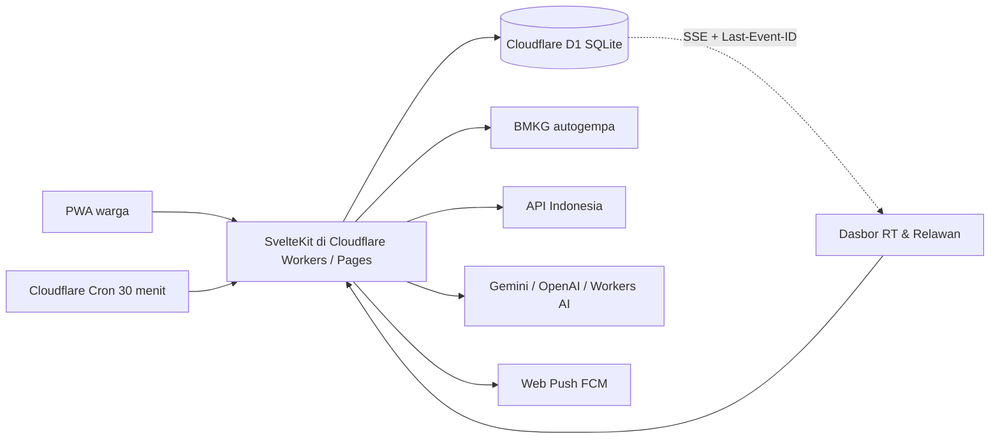

# Friendly Neighborhood

Jaringan siaga kelurahan. Warga menerima kabar peringatan, menekan **Saya aman** atau **Butuh bantuan**, dan ketua RT beserta relawan melihat siapa yang belum merespons. Antarmuka berbahasa Indonesia.

Mode demo berjalan langsung tanpa kunci API eksternal menggunakan database **Cloudflare D1 (SQLite)**: kelurahan contoh adalah **Kel. Tomang, Grogol Petamburan, Jakarta Barat**.

## Menjalankan Lokal

```sh
bun install
bun run d1:migrate:local
bun run dev
```

Aplikasi ada di [http://localhost:43721](http://localhost:43721). Saat pertama kali diakses, database D1 lokal otomatis terisi akun dan data contoh Kel. Tomang bila masih kosong.

Akun contoh, kata sandi `demo1234`:

| Peran | Nama | Nomor HP |
| --- | --- | --- |
| Warga | Sari Lestari | 081234567890 |
| Ketua RT | Dina Rahmawati | 081300000001 |
| Relawan | Rudi Hartanto | 081300000002 |

Skrip demo kompetisi: masuk sebagai Dina, buka **Simulasi siaga**, pilih **Hujan lebat**, mulai. Hartono Wijaya (lansia) muncul di urutan atas. Buka detailnya, ketuk **Saya cek**, status menjadi **Sedang dicek oleh Dina R.** secara atomik di database D1 (relawan lain tidak bisa mengklaim ganda, dan tab lain ikut berubah lewat SSE). Lalu **Tandai aman**.

## Arsitektur



- Backend berjalan penuh di **Cloudflare Workers & Pages** memakai `@sveltejs/adapter-cloudflare` dan database relasional **Cloudflare D1** (`migrations/0001_init.sql`).
- Klaim tombol **Saya cek** dieksekusi dengan query kondisional atomik di SQLite/D1 sehingga dua relawan tidak dapat mengklaim warga yang sama secara bersamaan.
- Sinkronisasi langsung antar-tab dan antar-isolate memakai Server-Sent Events (`GET /api/stream`) dengan tabel `live_events` dan header standar `Last-Event-ID`.
- Pantauan cuaca memakai API Indonesia hanya di sisi server. Gempa memakai umpan gratis `data.bmkg.go.id/DataMKG/TEWS/autogempa.json`.
- `SIMULASI` membuat kejadian berlabel `is_simulation` dan tidak memanggil API luar.
- Ringkasan AI (`POST /api/ai/ringkasan`) hanya mengirim angka agregat tanpa data pribadi perorangan. Mendukung `GEMINI_API_KEY`, `LLM_API_KEY` (OpenAI-compatible), binding Cloudflare Workers AI (`AI`), atau fallback templat otomatis.

## Variabel Lingkungan & Secret

Untuk pengembangan lokal, buat berkas `.dev.vars` (sudah diabaikan oleh `.gitignore`). Untuk produksi di Cloudflare, pasang secret menggunakan `bunx wrangler secret put <NAMA>`:

| Variabel | Fungsi |
| --- | --- |
| `SESSION_SECRET` | Kunci HMAC penanda sesi cookie (`fn_session`) |
| `API_INDONESIA_KEY` | Wilayah, cuaca, peringatan dini, fasilitas (`x-api-key`) |
| `GEMINI_API_KEY` atau `LLM_API_KEY` | Kunci model bahasa untuk ringkasan situasi agregat |
| `LLM_BASE_URL`, `LLM_MODEL` | Opsional; override endpoint/model OpenAI-compatible |
| `PUBLIC_VAPID_KEY`, `VAPID_PRIVATE_KEY`, `VAPID_SUBJECT` | Kunci VAPID untuk Web Push melalui FCM |
| `CRON_SECRET` | Melindungi endpoint `GET/POST /api/cron/poll` |

## Deploy ke Cloudflare Workers / Pages

### Opsi A — Cloudflare Workers + Static Assets + D1 + Cron (Direkomendasikan)

Satu perintah `deploy` akan membangun aplikasi, memasang handler Cron Trigger tiap 30 menit (`*/30 * * * *`), otomatis membuat database D1 `friendly-neighborhood-db` bila belum ada, dan mengunggah aset statis beserta Worker:

```sh
bunx wrangler login
bun run deploy
bun run d1:migrate:remote
```

Pasang secret produksi bila diperlukan:

```sh
bunx wrangler secret put SESSION_SECRET
bunx wrangler secret put API_INDONESIA_KEY
bunx wrangler secret put GEMINI_API_KEY
bunx wrangler secret put CRON_SECRET
```

Cek status backend yang sudah ter-deploy di `GET /api/health`.

### Opsi B — Cloudflare Pages

Jika ingin men-deploy sebagai proyek **Cloudflare Pages** (atau menghubungkan repositori GitHub ke menu **Workers & Pages > Create > Pages**):

1. Build command: `CF_PAGES=1 bun run build`
2. Build output directory: `.svelte-kit/cloudflare`
3. Tambahkan binding D1 bernama `DB` di **Settings > Bindings > D1 database** pada dashboard Pages.
4. Atau deploy langsung lewat CLI:

```sh
bun run deploy:pages
```

## API Indonesia

Basis: `https://use.apiindonesia.id`. Setiap permintaan berhasil memotong 2 kredit (Rp2). Permintaan gagal tidak dipotong. Akun baru mendapat bonus 3.000 kredit sekali.

Endpoint yang dipakai:

- `GET /api/v1/wilayah/provinsi`, `/kabupaten`, `/kecamatan`, `/kelurahan`
- `GET /api/v1/cuaca?adm4=`
- `GET /api/v1/peringatan-dini?provinsi=`
- `GET /api/v1/fasilitas/nearby`

Impor wilayah penuh ke Cloudflare D1:

```sh
API_INDONESIA_KEY=... bun run seed:wilayah          # ke D1 lokal
API_INDONESIA_KEY=... bun run seed:wilayah --remote # ke D1 produksi Cloudflare
```

## Firebase Cloud Messaging (Web Push)

1. Buat proyek Firebase dan tambahkan aplikasi web.
2. Di Cloud Messaging, buka Web Push certificates dan buat pasangan kunci VAPID.
3. Isi `PUBLIC_VAPID_KEY`, `VAPID_PRIVATE_KEY`, dan `VAPID_SUBJECT`.
4. Pengiriman Web Push dari Worker mengenkripsi payload (`aes128gcm` + header VAPID) dan mengirim langsung menggunakan Web `fetch` standar edge.

## Uji & Pemeriksaan Tipe

```sh
bun test
bun run check
bun run preview
```

## Tim Developer

Dikembangkan oleh tim mahasiswa:

- Casey Heraldo Isaac Pinontoan
- Matthew Eauggelion Pangemanan
- Sandra Miranda Salindeho
- Tesalonika Miracle Makalew

