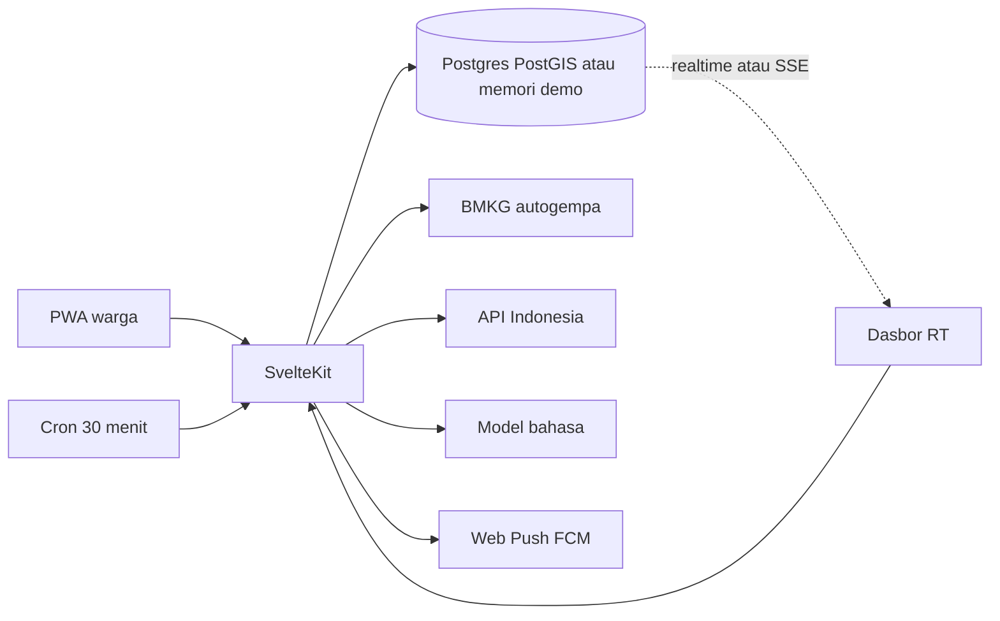

# Friendly Neighborhood

Jaringan siaga kelurahan. Warga menerima kabar peringatan, menekan **Saya aman** atau **Butuh bantuan**, dan ketua RT beserta relawan melihat siapa yang belum merespons. Antarmuka berbahasa Indonesia.

Mode demo berjalan tanpa kunci API: kelurahan contoh adalah **Kel. Tomang, Grogol Petamburan, Jakarta Barat**.

## Menjalankan

```sh
bun install
bun run dev
```

Aplikasi ada di [http://127.0.0.1:43721](http://127.0.0.1:43721).

Akun contoh, kata sandi `demo1234`:

| Peran | Nama | Nomor HP |
| --- | --- | --- |
| Warga | Sari Lestari | 081234567890 |
| Ketua RT | Dina Rahmawati | 081300000001 |
| Relawan | Rudi Hartanto | 081300000002 |

Skrip demo kompetisi: masuk sebagai Dina, buka **Simulasi siaga**, pilih **Hujan lebat**, mulai. Hartono Wijaya (lansia) muncul di urutan atas. Buka detailnya, ketuk **Saya cek**, status menjadi **Sedang dicek oleh Dina R.** di dasbor (tab lain ikut berubah). Lalu **Tandai aman**.

## Arsitektur



- Aplikasi yang berjalan memakai penyimpanan memori di proses Node dan SSE. Dua tab pada `bun run dev` melihat perubahan yang sama, tanpa kredensial.
- Skema Postgres, PostGIS, RLS, dan publikasi realtime ada di `supabase/migrations`. `bun run seed` mengisi akun demo ke Supabase bila URL dan service role sudah diisi. Jalur permintaan SvelteKit belum beralih ke klien Supabase; itu langkah berikut setelah proyek Supabase siap.
- Pantauan cuaca memakai API Indonesia hanya di server. Gempa memakai umpan gratis `data.bmkg.go.id/DataMKG/TEWS/autogempa.json` karena data gempa API Indonesia hanya diperbarui tiap jam.
- SIMULASI membuat kejadian `is_simulation` dan tidak memanggil API luar.
- Ringkasan AI hanya menerima angka agregat. Tanpa `LLM_API_KEY`, teks disusun dari templat.

## Variabel lingkungan

Salin `.env.example` ke `.env`.

| Variabel | Fungsi |
| --- | --- |
| `SESSION_SECRET` | Menandatangani sesi demo |
| `PUBLIC_SUPABASE_URL`, `PUBLIC_SUPABASE_ANON_KEY`, `SUPABASE_SERVICE_ROLE_KEY` | Postgres, Auth, Realtime |
| `API_INDONESIA_KEY` | Wilayah, cuaca, peringatan dini, fasilitas. Header `x-api-key` |
| `LLM_API_KEY`, `LLM_BASE_URL`, `LLM_MODEL` | Ringkasan situasi |
| `PUBLIC_VAPID_KEY`, `VAPID_PRIVATE_KEY`, `VAPID_SUBJECT` | Web Push |
| `CRON_SECRET` | Melindungi `POST /api/cron/poll` |
| `APP_URL` | Dipakai Edge Function untuk meneruskan cron |

## Supabase

1. Buat proyek di [supabase.com](https://supabase.com). Aktifkan PostGIS.
2. Jalankan `supabase/migrations/20261111120000_init.sql` di SQL editor.
3. Isi ketiga variabel Supabase, lalu `bun run seed`.
4. Realtime sudah memublikasikan `checkins`, `events`, dan `announcements`.
5. Jadwal pg_cron ada di `supabase/cron.sql`. Ganti URL fungsi dan rahasia, lalu jalankan berkas itu.
6. Edge Function `poll-warnings` dan `ai-summary` meneruskan ke aplikasi. Set `APP_URL` dan `CRON_SECRET` di secret fungsi.

RLS: warga hanya membaca dan mengubah data sendiri. Kerentanan warga lain hanya terlihat oleh ketua RT dan relawan di kelurahan yang sama. Service role dipakai skrip seed dan cron, bukan peramban.

## API Indonesia

Basis: `https://use.apiindonesia.id`. Setiap permintaan berhasil memotong 2 kredit (Rp2). Permintaan gagal tidak dipotong. Tidak ada kuota bulanan gratis. Akun baru mendapat bonus 3.000 kredit sekali.

Endpoint yang dipakai:

- `GET /api/v1/wilayah/provinsi`, `/kabupaten`, `/kecamatan`, `/kelurahan`
- `GET /api/v1/cuaca?adm4=`
- `GET /api/v1/peringatan-dini?provinsi=`
- `GET /api/v1/fasilitas/nearby`

Panggilan hanya dari server. Peramban mencari wilayah yang sudah diimpor. Fasilitas di-cache per kelurahan. Cron peringatan dini hanya menyentuh provinsi yang punya warga terdaftar, dan menggabungkan peringatan yang sama supaya tidak mengirim notifikasi dua kali.

Impor wilayah sekali:

```sh
bun run seed:wilayah
```

Perkiraan biaya impor penuh lewat daftar berhalaman (`per_page=100`), bukan satu permintaan per induk:

| Data | Permintaan | Biaya |
| --- | --- | --- |
| Provinsi | 1 | Rp2 |
| Kabupaten/kota | 6 | Rp12 |
| Kecamatan | 73 | Rp146 |
| Kelurahan/desa | 838 | Rp1.676 |
| **Jumlah** | **918** | **Rp1.836** |

Batas GeoJSON sengaja tidak diimpor. Satu permintaan per kelurahan akan menambah puluhan ribu rupiah dan tidak dibutuhkan untuk MVP.

Biaya berjalan untuk satu kelurahan di satu provinsi, cron tiap 30 menit:

| Pemakaian | Irama | Biaya |
| --- | --- | --- |
| Peringatan dini | 48 kali/hari untuk satu provinsi | Rp96/hari |
| Prakiraan cuaca | cache 6 jam, 4 kali/hari per kelurahan | Rp8/hari |
| Fasilitas | sekali per kabupaten, lalu cache | Rp10 |
| Gempa | umpan BMKG langsung | Rp0 |
| SIMULASI | tidak memanggil API | Rp0 |

Bonus 3.000 kredit cukup untuk impor wilayah dan kira-kira dua minggu pantauan satu provinsi. Naikkan jeda cron bila kelurahan yang terdaftar masih sedikit. Jangan mem-poll `/api/v1/gempa`: sumber itu ikut berbayar dan hanya segar tiap jam.

## Firebase Cloud Messaging

Web Push Chrome lewat FCM.

1. Buat proyek Firebase dan tambahkan aplikasi web.
2. Di Cloud Messaging, buka Web Push certificates dan buat pasangan kunci VAPID.
3. Isi `PUBLIC_VAPID_KEY`, `VAPID_PRIVATE_KEY`, dan `VAPID_SUBJECT`.
4. Warga mengizinkan notifikasi di langkah izin. Langganan disimpan di profil.
5. Tanpa kunci, kabar siaga tetap muncul di aplikasi yang sedang terbuka dan lewat Notification API. Pengiriman saat aplikasi tertutup membutuhkan kunci di atas.

## Vercel

`vercel.json` menjadwalkan `GET /api/cron/poll` tiap 30 menit. Set `CRON_SECRET` di proyek Vercel; platform mengirimnya sebagai `Authorization: Bearer`.

```sh
bun run build
```

Adapter yang terpasang adalah `@sveltejs/adapter-vercel`. Set variabel yang sama dengan `.env.example` di dashboard Vercel. `PUBLIC_*` ikut ke peramban. Jangan menaruh `API_INDONESIA_KEY` atau service role di variabel `PUBLIC_`.

## Yang masih mock

- Akun, respons, dan dasbor yang terlihat di `bun run dev` ada di memori proses, bukan Postgres. Migrasi dan `bun run seed` menyiapkan database yang sama.
- Tanpa `API_INDONESIA_KEY`, cuaca, peringatan, dan fasilitas Kel. Tomang adalah data contoh berlabel **Berdasarkan data yang tersedia**.
- Tanpa kunci VAPID, push jarak jauh tidak terkirim.
- Tanpa `LLM_API_KEY`, ringkasan adalah templat dari angka agregat. Nama, alamat, koordinat, dan kerentanan per orang tidak masuk ke payload model.
- Kode wilayah di fixture demo mengikuti pola Kemendagri untuk alur pilih wilayah. `bun run seed:wilayah` menggantinya dengan data resmi.

## Uji

```sh
bun test
bun run check
```

## Tim Developer

Dikembangkan oleh tim mahasiswa Sistem Informasi, Universitas Tarumanagara:

- Tesalonika Miracle Makalew
- Sandra Miranda Salindeho
- Casey Heraldo Isaac Pinontoan
- Matthew Eauggelion Pangemanan
